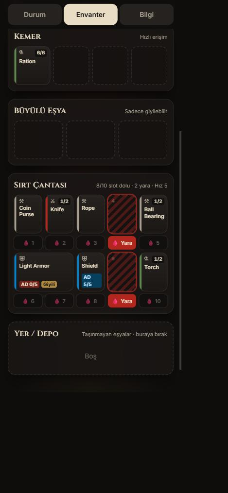
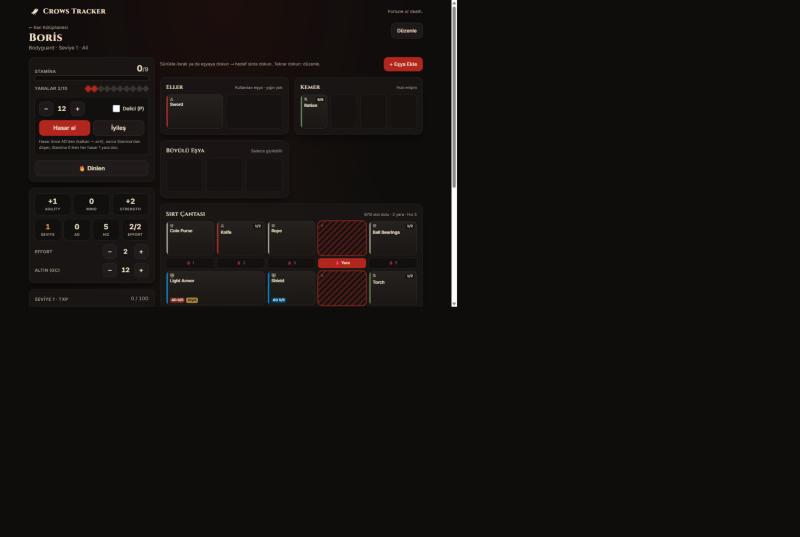
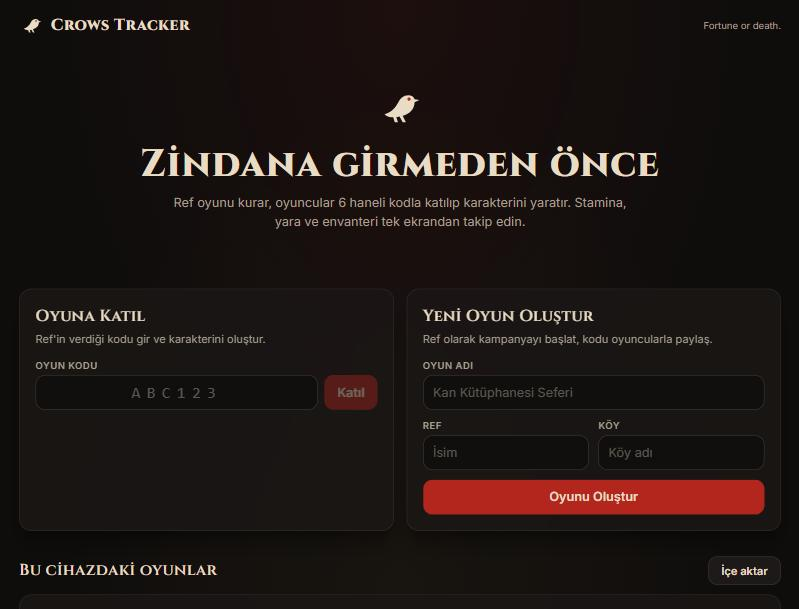
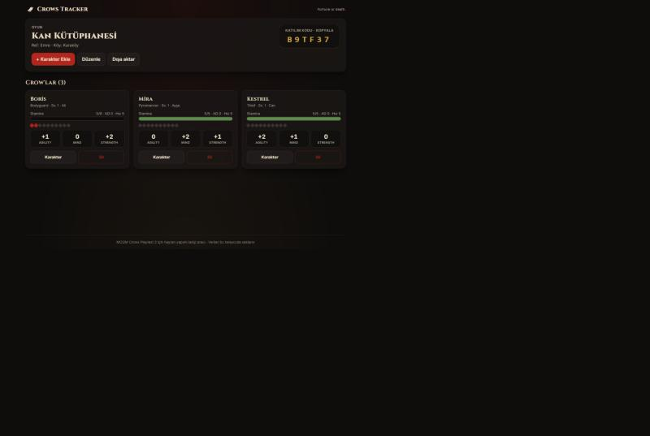

# Crows Tracker 🐦‍⬛

MCDM'in survival-horror zindan oyunu **Crows (Public Playtest 3)** için oyun yönetimi, karakter oluşturma, Stamina/yara ve envanter takip uygulaması.

🌐 **Canlı:** https://crows-tracker-tr.netlify.app  
📦 **Kaynak kod:** https://github.com/Elif-Yildiz/crows-tracker

Ref (oyun yöneticisi) bir oyun oluşturur ve 6 haneli **katılım kodunu** oyuncularla paylaşır. Oyuncular bu kodla oyuna katılıp kural kitabındaki adımlarla karakterlerini yaratır. Ardından karakter statları, Stamina, AD (zırh), yaralar, Effort, XP, altın ve **sürükle-bırak envanter** tek ekrandan takip edilir.

> Web Geliştirme; Yapay Zeka Proje Yönergesi (2026) kapsamında hazırlanmıştır.

## Ekran Görüntüleri

| Mobil envanter | Masaüstü karakter sayfası |
| --- | --- |
|  |  |

| Ana sayfa | Oyun ve crow listesi |
| --- | --- |
|  |  |

## Özellikler

- **Oyun oluşturma & kodla katılma:** Her oyuna karışması zor harflerden 6 haneli kod verilir (`B9TF37` gibi).
- **Karakter oluşturma (Crow Creation):** 36 background'dan seçim ya da **2d6 zar** atma; background'a göre Stamina, trait, expertise ve başlangıç ekipmanı otomatik gelir. Karakteristikler kurala göre dağıtılır (biri 2, diğerleri +1/0 veya −1/+2). Altın 3d6 ile atılır.
- **Stat takibi:** Agility / Mind / Strength, seviye (TXP tablosundan), Effort, AD, hız.
- **Hasar ve can:** "Hasar al" önce AD'yi (elde kalkan → giyili zırh), sonra Stamina'yı düşürür; Stamina 0 iken her hasar 1 **yara** olur ve sırt çantası slotuna yerleşir. Delici (P) hasar AD'yi atlar. "Dinlen" Stamina'yı doldurur, 1 yarayı iyileştirir, Effort'u yeniler. 10 yarada karakter ölür.
- **Envanter (kitaptaki envanter kağıdı):** 2 el, 4 kemer, 3 büyülü eşya ve 10 sırt çantası slotu.
  - **Sürükle-bırak** (fare ve dokunmatik, `@dnd-kit/core`), taşınabilecek slotlar sürüklerken altınla vurgulanır, geçersiz hedef kırmızı olur.
  - **Dokun-taşı:** Eşyaya dokun → hedef slota dokun. Aynı eşyaya tekrar dokun → düzenle.
  - Kurallar uygulanır: çok slotlu eşyalar (Light Armor 2, Heavy Armor 4…) aynı sırada yan yana durur; elde yığın tutulamaz (yığından 1 tane alınır); büyülü slotlara yalnızca giyilebilir eşyalar konur; aynı eşyalar yığın sınırına kadar birleşir; dolu slota bırakınca eşyalar **yer değiştirir**.
  - Yara şeridi: her sırt çantası slotunun altında yara aç/kapa; yara + eşya olan her slot hızı 1 düşürür.
  - Eşya kataloğu (kart PDF'lerinden), özel eşya/hazine ekleme, yığın bölme, not, AD onarımı, zırh giyme.
- **Mobil uyumlu:** Mobilde Durum/Envanter/Bilgi sekmeleri, alttan açılan pencereler, 44px+ dokunma alanları; geniş ekranda iki sütun.
- **Canlı senkron (Firebase Firestore):** Oyunlar ve karakterler bulutta tutulur; farklı telefon ve bilgisayarlar aynı oyunu anında görür (Ref'in ekranında oyuncunun Stamina'sı canlı değişir). Çevrimdışıyken yapılan değişiklikler bağlantı gelince gönderilir. Oyun JSON olarak yedeklenip yeni bir oyun olarak geri yüklenebilir.

## Yönergedeki CRUD işlemleri

| İşlem | Oyun | Karakter | Eşya |
| --- | --- | --- | --- |
| **Ekle** | Yeni Oyun Oluştur | Kodla katıl → Crow Yarat | + Eşya Ekle |
| **Listele** | Bu cihazdaki oyunlar | Oyun sayfasında crow kartları | Envanter panosu |
| **Güncelle** | Oyunu düzenle | Karakteri düzenle, hasar/iyileş/dinlen, XP, altın, notlar | Taşı/yer değiştir, adet, AD, not, giy |
| **Sil** | Oyun kartında Sil | Karakteri sil | Eşya düzenleyicide Sil |

## Teknolojiler

- **React 19 + TypeScript** (Vite ile kurulum)
- **Tailwind CSS v4**
- **React Router** (sayfalar)
- **@dnd-kit/core** (sürükle-bırak; fare, dokunmatik ve klavye sensörleri)
- **Firebase Firestore** (ücretsiz Spark planı; `onSnapshot` ile gerçek zamanlı dinleme, `useSyncExternalStore` ile reaktif depo)
- **LocalStorage** (yalnızca bu cihazın oyun listesi ve cihaz kimliği)

## Klasör yapısı

```
src/
├── interfaces/      # TypeScript arayüzleri (Game, Character, Item…)
├── pages/           # HomePage, GamePage, CharacterCreatePage, CharacterPage, NotFound
├── components/      # Layout, ui (Modal, Toast, Stepper), StatusPanel, CharacterBits…
│   └── inventory/   # InventoryBoard, ItemTile, ItemEditor, AddItemModal
├── services/        # firebase (bağlantı), storage (Firestore CRUD + canlı dinleme), inventory (kurallar), characterFactory
└── data/            # backgrounds, items (kart kataloğu), rules (seviye tablosu, slotlar)
```

## Kurulum

Gereksinim: [Node.js](https://nodejs.org) 20+.

Firebase ayarları ortam değişkenlerinden okunur. `.env.example` dosyasını `.env.local` olarak kopyalayıp Firebase konsolundaki web uygulaması değerleriyle doldurun (`.env.local` depoya eklenmez).

```bash
cp .env.example .env.local   # sonra değerleri doldurun
npm install
npm run dev      # http://localhost:5173
npm run build    # dist/ klasörüne üretim çıktısı
```

## Veri modeli ve güvenlik (Firebase)

```
games/{gameId}                      → Game (id, code, name, refName, village, ownerUid, createdAt)
games/{gameId}/characters/{charId}  → Character (statlar, Stamina, yaralar, envanter…)
```

- Hesap/giriş gerekmez. Her tarayıcı kendine rastgele bir **cihaz kimliği** üretir; oyunu kuran cihaz oyunu düzenleyip silebilir.
- `firestore.rules`: oyunlar yalnızca kodla (`limit 1`) bulunabilir, toplu listeleme yasaktır; yazılan veriler biçim ve boyut açısından doğrulanır; oyunun kodu ve sahibi değiştirilemez.
- Kuralları yüklemek: `npx firebase deploy --only firestore:rules`

## Yayına alma (Netlify)

Projede `netlify.toml` hazır (build: `npm run build`, publish: `dist`, SPA yönlendirmesi).

1. Projeyi GitHub'a public bir depo olarak yükleyin (bu proje: https://github.com/Elif-Yildiz/crows-tracker).
2. Netlify → **Add new site → Import an existing project** → depoyu seçin → **Deploy**.

## Not

Bu proje, MCDM'in Crows Public Playtest 3 materyallerine dayanan, resmi olmayan bir hayran yapımıdır. Crows © MCDM Productions.
